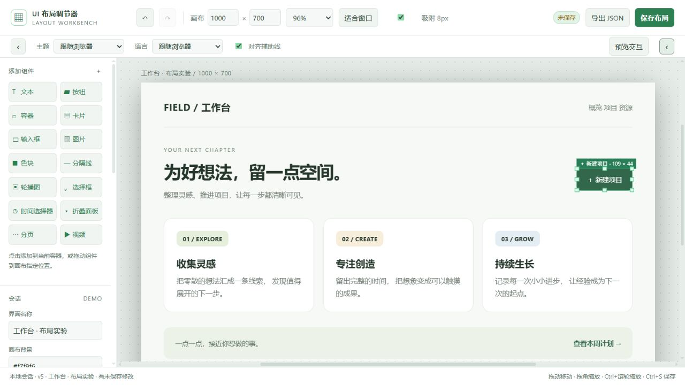

# UI Layout Adjuster · UI 布局调节器

**可视化调节界面布局的 Codex skill：拖动、缩放、修改样式并添加组件，保存后将差异应用回原项目。**

**A Codex skill for visual UI layout editing: move and resize elements, edit styles, add components, and apply saved changes back to your project.**

[中文说明](#中文说明) · [English](#english)



## 中文说明

### 工作方式

将选定的网页、源码组件、桌面界面或截图转换为 HTML 子页面，在通用父编辑器中调整。所有编辑工具、拖放事件、选框和保存功能都属于父页面；子页面放在同源 iframe 中，不运行原页面脚本。

保存后，Codex 根据来源映射与差异清单修改真实项目。会先识别项目实际使用的 UI 框架，优先复用已有组件、主题和布局 API；没有 UI 组件框架时使用通用、简洁的原生能力，尽量不引入依赖。仅修改有改动的内容，保留现有业务逻辑、事件和绑定。

### 功能

- 拖动移动、八方向缩放、图层、父容器和顺序调整、样式面板、复制/删除、撤销/重做。
- 从组件库直接拖到目标位置；组件对齐虚线及边缘/中心吸附；Ctrl＋滚轮以鼠标位置为中心缩放工作区。
- 文本、按钮、容器、卡片、输入框、图片、色块、分隔线、轮播图、选择框、时间选择器、折叠面板、分页、视频。
- 本地图片/视频上传，轮播图支持多选图片；服务模式单文件最大 100 MB，离线模式最大 4 MB。
- 原生控件和轮播/分页交互预览；预览操作不改变保存的默认状态。
- 深色/浅色主题和中文/English，默认跟随浏览器配置；左右侧栏独立收起并记住状态。
- JSON 导入导出、草稿恢复、本地保存、版本冲突检查及源文件哈希校验。

### 安装与触发

下载或克隆本仓库，将包含 `SKILL.md` 的仓库目录放入 `~/.codex/skills/ui-layout-adjuster/`。Windows 对应 `%USERPROFILE%\.codex\skills\ui-layout-adjuster\`。若目标目录已有此 skill，先保留自己的修改再更新。

在 Codex 中提供目标页面的文件、路由、选区或截图，然后说：

```text
使用布局调节器调节登录页面
调节订单管理页面布局
```

也支持显式调用 `$ui-layout-adjuster`。调整完成后点击“保存布局”，再告诉 Codex：

```text
应用已保存布局
```

### 本地示例

需要 Python 3，无第三方 Python 运行依赖。在仓库根目录执行：

```sh
python scripts/layout_session.py init --session ./sessions/demo --demo
python scripts/layout_session.py serve --session ./sessions/demo --port 0
```

在浏览器打开终端打印的 `EDITOR_URL`。服务只监听 `127.0.0.1`。离线打开生成的 `editor.html` 也可编辑，保存时下载 JSON；离线保存不会自动写回会话。

正式会话使用 `init --model <布局JSON> --source-root <项目目录>`。这是由 Codex 按适配说明建立的可编辑代理，不是任意应用的自动逆向工具。

### 支持范围与限制

| 输入 | 调整后 |
| --- | --- |
| Web、React/Vue 等源码 | 将保存差异应用到对应组件和样式 |
| Qt/QML、WPF 等桌面源码 | 将 HTML 代理中的调整翻译回原控件与布局体系 |
| 截图或设计图 | 有源码时补充映射回写；无源码时生成重建界面 |

截图不能恢复业务逻辑；没有源码时不能修改原应用。复杂原生控件、canvas、SVG、阴影 DOM、伪元素与特殊字体可能需要补充代理。分页数据请求、轮播自动播放等业务行为由原项目实现承接。交付或迁移页面时需要携带被引用的 `media/` 文件。

## English

### How it works

Convert a selected web page, source component, desktop interface, or screenshot into a child HTML page and edit it in a reusable parent editor. Editing tools, drag/drop events, selection overlays, and persistence belong to the parent. The child is rendered in a same-origin iframe without running the original page's scripts.

After you save, Codex uses source mappings and the change manifest to update your project. It detects the UI framework actually used by the project and prefers its existing components, themes, and layout APIs. Without a UI component framework, it uses simple native capabilities and avoids additional dependencies where possible. Only changed parts are applied, preserving business logic, events, and bindings.

### Features

- Dragging, eight-direction resizing, layers, parent/order changes, style editing, duplicate/delete, undo/redo.
- Drag components directly from the palette to their destination; dashed alignment guides with edge/center snapping; Ctrl+wheel workspace zoom around the pointer.
- Text, buttons, containers, cards, inputs, images, rectangles, dividers, carousels, selects, time pickers, accordions, pagination, and video.
- Local image/video uploads and multiple carousel images: up to 100 MB per file in server mode or 4 MB in offline mode.
- Native-control, carousel, and pagination previews without changing saved defaults.
- Light/dark themes and Chinese/English, initially following browser preferences; independently collapsible sidebars with remembered state.
- JSON import/export, draft recovery, local saves, revision conflict detection, and source-file hash checks.

### Installation and invocation

Download or clone this repository into `~/.codex/skills/ui-layout-adjuster/`, with `SKILL.md` directly inside that directory. On Windows, use `%USERPROFILE%\.codex\skills\ui-layout-adjuster\`. Preserve any local modifications before replacing an existing installation.

Provide the target page's files, route, selection, or screenshot in Codex. The configured natural-language triggers are:

```text
使用布局调节器调节登录页面
调节订单管理页面布局
```

These mean “use the layout adjuster to adjust the login page” and “adjust the order management page layout.” You can also invoke the skill explicitly in English:

```text
Use $ui-layout-adjuster to adjust the login page layout.
```

When finished, click **Save layout** and ask Codex to **apply the saved layout**.

### Try the local demo

Python 3 is required; there are no third-party Python runtime dependencies. Run these commands from the repository root:

```sh
python scripts/layout_session.py init --session ./sessions/demo --demo
python scripts/layout_session.py serve --session ./sessions/demo --port 0
```

Open the printed `EDITOR_URL` in your browser. The server listens on `127.0.0.1` only. You can also open the generated `editor.html` offline; saving downloads JSON instead of automatically updating the session.

For a real interface, use `init --model <layout.json> --source-root <project>`. Codex builds an editable proxy using the adapter instructions; this is not an automatic reverse-engineering tool for arbitrary applications.

### Scope and limitations

| Input | Applying the result |
| --- | --- |
| Web, React/Vue, and other source components | Update the corresponding components and styles |
| Qt/QML, WPF, and other desktop source | Translate HTML proxy changes into the original controls and layout system |
| Screenshots or designs | Map back to available source, or generate a reconstructed interface |

Screenshots cannot recover business logic, and unavailable source cannot be modified. Complex native controls, canvas, SVG, shadow DOM, pseudo-elements, and special fonts may need additional proxies. Business behavior such as data-backed pagination and carousel autoplay is implemented in the original project. Keep referenced `media/` files with exported or migrated pages.

## Files · 文件

| Path | Purpose · 用途 |
| --- | --- |
| [SKILL.md](SKILL.md) | Skill instructions and invocation rules · skill 指令与触发规则 |
| [agents/openai.yaml](agents/openai.yaml) | Skill display metadata · 展示元数据 |
| [assets/](assets/) | Parent editor, preferences, and alignment logic · 父编辑器、偏好和对齐逻辑 |
| [scripts/layout_session.py](scripts/layout_session.py) | Session creation, local server, saves, and verification · 会话、本地服务、保存与校验 |
| [scripts/capture.js](scripts/capture.js) | Read-only DOM capture helper · 只读 DOM 采集辅助函数 |
| [references/adapters.md](references/adapters.md) | Source adapter and minimal-change guidance · 来源适配与最小修改说明 |
| [references/model.md](references/model.md) | Layout model and saved artifacts · 布局模型与保存文件 |
